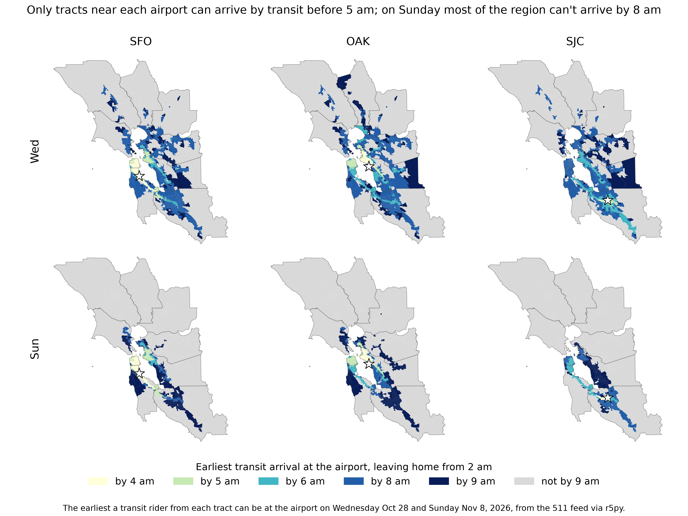
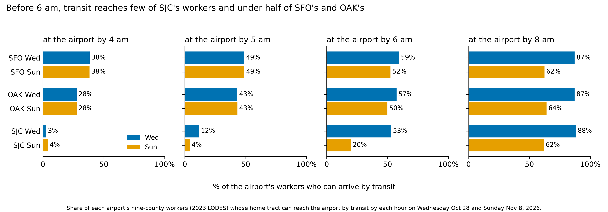
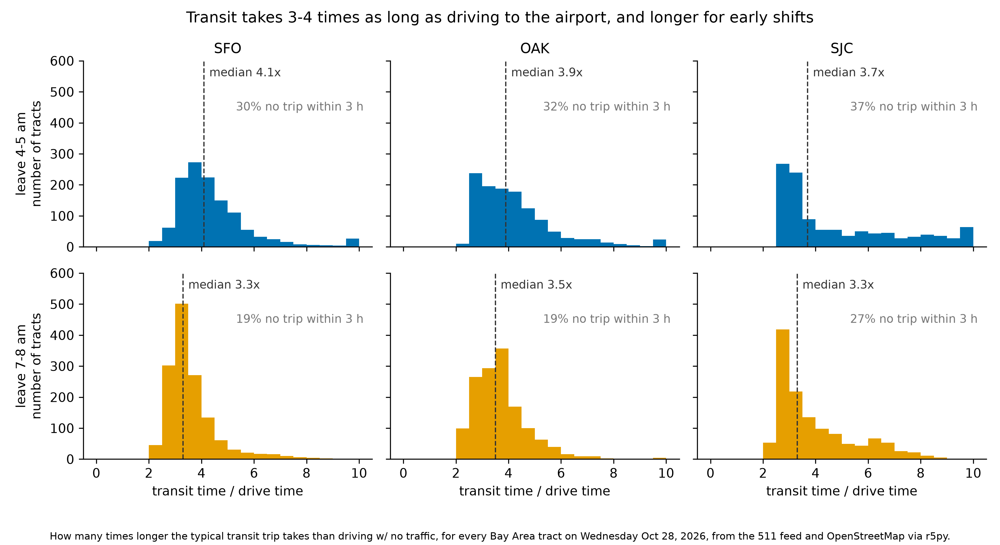
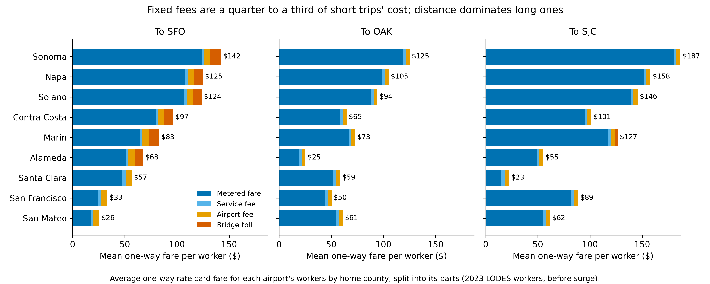

# Airport Transit Feasibility

Can Bay Area airport workers get to SFO, OAK and SJC by transit in time for early shifts, and what does the alternative cost?

Using 2023 LODES jobs data, the 511 regional transit schedules and the OpenStreetMap drive network, we estimate, for every home tract of SFO, OAK and SJC workers, the earliest transit arrival at the airport, typical early-morning transit trip times, free-flow drive times and the rideshare fare for the same trip.

## Early findings

Code and data: [github.com/aditchintamaneni/AirportTransitFeasibility](https://github.com/aditchintamaneni/AirportTransitFeasibility)
